# Rutina Óptima — High-Performance Biological & Time-Allocation System

  <strong>Deterministic Weekly Schedule, V-Taper Hypertrophy Protocol & Circadian HGH Optimization Dashboard</strong> 
  Engineered by <a href="https://github.com/iamhuitron"><strong>Ian Miguel Delgado Huitrón</strong></a> (<code>@iamhuitron</code>) · Co-Founder at <a href="https://github.com/Xaol-Studio"><strong>@Xaol-Studio</strong></a>

  
  

  
  
  

---

## 📌 Problem & Operational Context

Balancing an evening university engineering degree (**UNAM — FES Cuautitlán**), **20 hours/week of remote software engineering**, **4.5 hours of daily transit**, and physical hypertrophy without burning out requires treating daily time and endocrine recovery as a deterministic systems problem.

**Rutina Óptima** is a mobile-first operational command center that structures every hour of the week around circadian biology, deep-work blocks, transit knowledge compounding, and complete Sunday recovery.

---

## 🏗️ System Architecture & Daily Allocation Flow

```mermaid
%%{init: {'theme': 'base', 'themeVariables': { 'primaryColor': '#141210', 'primaryTextColor': '#FAF8F5', 'primaryBorderColor': '#B89758', 'lineColor': '#B89758', 'secondaryColor': '#1D1A16', 'tertiaryColor': '#0D0C0A', 'mainBkg': '#141210', 'nodeBorder': '#B89758', 'clusterBkg': '#0D0C0A', 'clusterBorder': '#262420', 'titleColor': '#D4B87A', 'edgeLabelBackground': '#141210', 'fontFamily': 'JetBrains Mono, Plus Jakarta Sans, sans-serif' }}}%%
flowchart LR
    A["06:45 - 08:30<br/>Spinal Decompression & V-Taper"] --> B["08:30 - 11:30<br/>Deep Remote Engineering (3h/day)"]
    B --> C["12:00 - 14:00<br/>Inbound Transit (Active Reading)"]
    C --> D["14:00 - 20:00<br/>UNAM Classes + Gap Shield"]
    D --> E["20:00 - 22:30<br/>Outbound Transit (NSDR / Rest)"]
    E --> F["22:30 - 06:45<br/>Zero-Insulin Dinner & N3 HGH Pulse"]
```

---

## ⚡ Core Modules

| Module | Operational Objective | Key Mechanism |
| :--- | :--- | :--- |
| **📅 Horario Semanal** | Interactive 7-day timeline with real-time category filtering | Balances 20h remote work (Mon–Sat AM) to guarantee 100% free Sundays |
| **🧬 HGH & Estatura** | Maximize endogenous somatropin during N3 slow-wave sleep | Nocturnal insulin suppression + morning/night 120s spinal dead hangs |
| **🏋️ Físico V-Taper** | High-density 40-min home hypertrophy without gym commute | Clavicular width, lateral deltoids, weighted calisthenics & stomach vacuum |
| **🥗 Nutrición & Aseo** | Fixed metabolic fueling & personal grooming windows | Leucine/choline breakfast, pre-transit complex carbs, thermal shower shift |
| **🧭 Estrategia 4.5h** | Turn 4.5h of daily public transit into an asymmetric advantage | 2h inbound reading (~30 books/yr) + zero-homework-at-home library shield |

---

## 🎨 Visual Identity & Design Tokens

Aligned with the **High-Performance Engineering & Sartorial Editorial** personal brand kit:
- **Canvas & Surfaces:** Obsidian Void (`#0D0C0A`), Espresso Surface (`#141210`), Elevated (`#1D1A16`), Subtle 1px Borders (`#262420`).
- **Signature Accents:** Old Gold (`#B89758`), Champagne (`#D4B87A`), Imperial Burgundy (`#611624`), Forest Spruce (`#1B3B2B`).
- **Typography:** `Playfair Display` (Editorial headers), `Plus Jakarta Sans` (UI copy), `JetBrains Mono` (Timeblocks & telemetry).

---

## 🚀 Deployment

Deployed at the edge via **Vercel**:
- **Live URL:** [https://rutina-optima.vercel.app/](https://rutina-optima.vercel.app/)
